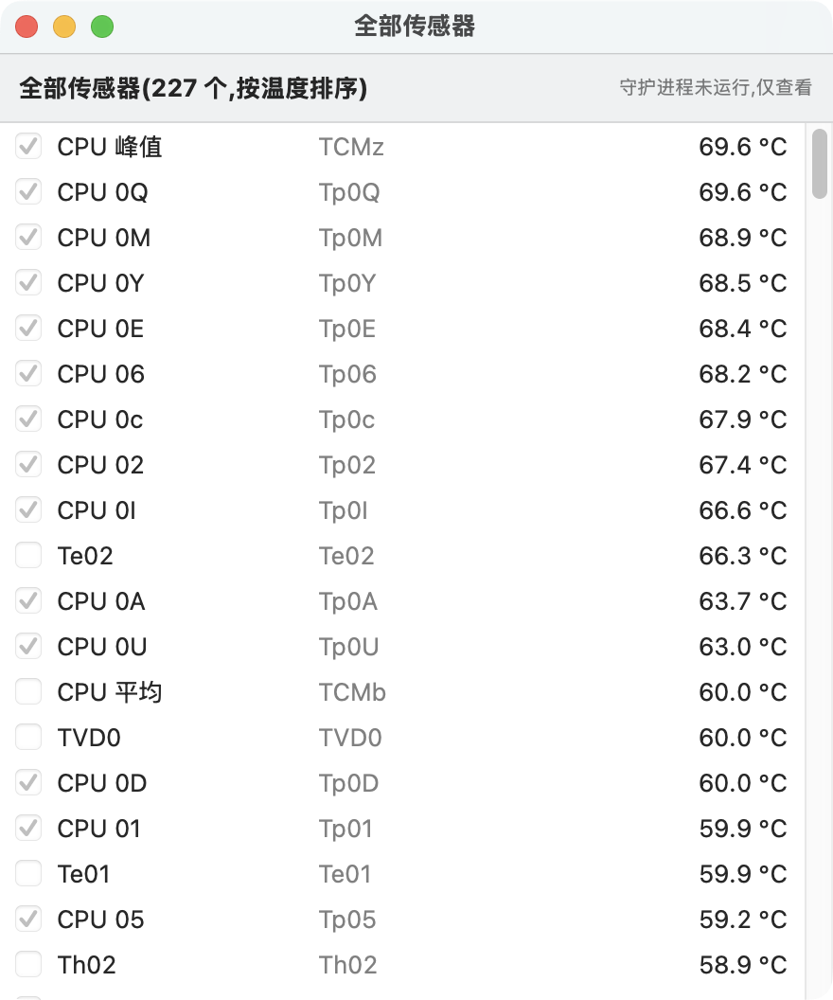

# MacFanControl 🌡️

**免费开源的 macOS 风扇温度控制 + 系统监控菜单栏应用** —— 自研替代 Macs Fan Control / TG Pro / iStat Menus 的国产良心小工具。

  

> 在 16" MacBook Pro(M1 Max / macOS 26)上开发并长期实测。

## 截图

| 菜单栏监控面板 | 设置窗口(完整面板) |
|:---:|:---:|
|  |  |

| 全部传感器窗口 | 菜单栏图标 |
|:---:|:---:|
|  |  |

## 功能特性

### 🌡 温度与风扇控制
- **多点温度曲线**:分段线性、每个风扇独立曲线、可视化编辑器(旧两点直线只是它的特例)
- **插电/电池两套曲线**:拔掉电源自动切到电池曲线(更安静/更省电),插回自动恢复,一键复制
- **定时夜间模式**:设定时间窗(如 23:00–07:00,支持跨午夜)自动改用所选预设,夜间降噪
- **手动模式**:锁定任意转速;一键全速(应急)
- **三档预设**:安静 / 均衡 / 强力
- **传感器可选**:全部温度传感器任选参与控制(取最大值),内置百余键名中文对照库
- **回滞防抖**:温度回落 1.5°C 以内不降速,杜绝阈值附近转速抖动
- **风扇故障告警**:转速骤降为 0 且目标不为 0 时发通知,轴承老化早知道
- **安全兜底**:转速永远夹在硬件安全区间;退出自动恢复系统控制;写入被动验证、防系统抢写
- **多机型策略**:M1/M2 直写目标转速;M3/M4 自动 `Ftst` 诊断解锁;M5 小写键自适应;Intel 走最小转速通道

### 📊 系统监控
- **菜单栏标题自定义**:温度 / CPU / GPU / 内存 / 网速 / 电池 / 实时功率任意组合显示
- CPU:总占用 + 每核柱状图 + **Top 5 占用进程(右击可直接结束进程,支持 CPU/内存排序)**
- **GPU 占用率**(Apple Silicon,读自 IOAccelerator 硬件统计)
- 内存(占用 + **内存压力分级 + Swap 用量警示**)、电池(电量/循环/健康度/**实时充放电功率 + 今日用电 Wh**/充满 80% 与低电量提醒)、硬盘(空间 + 实时读写速度)
- 网速(实时 ↓↑)+ 今日流量统计;**15 分钟**温度/CPU/GPU/风扇历史曲线
- **今日峰值记录**:最高温 / CPU 峰值 / 放电峰值功率 / 今日用电量
- **7 天小时级趋势图**(温度/CPU/GPU 切换),**数据一键导出 CSV**

### 🖱 易用性与工程
- 菜单栏图标**右键快捷菜单**(全速/预设/复制状态/导出 CSV);面板内多处右键菜单
- **中英双语**(按系统语言自动切换);[English README](README_EN.md)
- **版本检查**(自动提示 GitHub 新版本);**一键导出诊断包**
- 崩溃自动恢复(LaunchAgent);守护进程**看门狗自愈** + 轻量化采样(SMC 调用量降 90%)
- CI 自动发版:推 `v*` 标签即自动构建并发布 Release;17 个单元测试守护核心逻辑

## 安装

**方式一:下载发布包**

从 [Releases](../../releases) 下载 DMG → 拖入应用程序 → 打开。
首次打开如提示"无法验证开发者":右键图标 → 打开 → 再点"打开"(自制软件无苹果公证,仅需一次)。

**方式二:源码构建**(需 Xcode 命令行工具)

```bash
git clone https://github.com/skydeadpeng/MacFanControl.git
cd MacFanControl
./build.sh
open build/FanBar.app
```

**启用风扇控制(可选)**:监控功能零权限直接用;要让风扇听指挥,点面板里的"安装守护进程",输一次管理员密码即可(守护进程常驻,开机自启)。

## 工作原理

```
┌────────────┐  unix socket (JSON)   ┌──────────────────────┐  IOKit/AppleSMC   ┌───────┐
│  FanBar.app │ ◄──────────────────► │  fanctl 守护进程(root) │ ◄───────────────► │  SMC  │
│  菜单栏 GUI  │   状态/配置/报警        │  温度→曲线→目标转速     │   读温度/写风扇     │ 硬件  │
└────────────┘                       └──────────────────────┘                  └───────┘
```

- **读温度/转速**:通过 `AppleSMC` IOKit 服务读写 SMC 键(如 `TCxx`/`Tp0x` CPU 核心、`TCMz` 峰值、`F0Ac` 实际转速),Apple Silicon 上数值为小端 IEEE754
- **写风扇**:root 守护进程写 `F%dTg`(目标转速)/`F%dMd`(模式);`thermalmonitord` 抢写时由被动验证自动重写
- 纯 Swift 实现,无任何第三方依赖;SMCKit 库可直接复用到你自己的项目

## 命令行 fanctl

安装守护进程后可用:

```
fanctl sensors                 列出温度传感器
fanctl fans                    查看风扇状态
fanctl status                  控制状态
fanctl set curve 60 85         起转/全速温度
fanctl set mode auto|manual    自动曲线 / 手动转速
fanctl set rpm 0 4000          手动模式下设定转速
fanctl set sensors TCMz,Tp01   指定控制传感器
fanctl restore                 恢复系统控制
sudo fanctl test 0 3500        直接控制测试(10秒后自动恢复)
sudo fanctl install/uninstall  安装/卸载守护进程
fanctl log                     查看日志
```

## 支持机型

| 机型 | 状态 |
|---|---|
| MacBook Pro / Mac mini / Mac Studio / iMac(Apple Silicon M1–M5) | ✅ 完整支持(M3/M4 首次接管需数秒) |
| Intel Mac | ✅ 支持(走 F%dMn 最小转速通道) |
| MacBook Air(无风扇) | 📊 仅监控 |
| macOS 版本 | 13 Ventura 及以上 |

## 常见问题

- **界面显示"系统控制/未生效"?** 确认已安装守护进程(`sudo fanctl install`);M3/M4 机型接管需要几秒
- **风扇转速和目标来回跳?** 系统热管理在抢写,`fanctl set interval 1` 调快重写频率
- **为什么需要密码?** 写风扇寄存器必须 root,和所有同类软件一致;密码只在安装/更新守护进程时需要
- **卸载?** 面板 → 恢复系统控制 → 卸载守护进程 → 退出,删 app 即可

## 从源码构建 / 项目结构

```
Sources/SMCKit/      SMC 通信库(协议结构、编解码、风扇写入策略、配置、socket)
Sources/fanctl/      命令行工具 + root 守护进程
Sources/FanBar/      菜单栏 GUI(SwiftUI + NSStatusItem,含系统监控采样)
build.sh             构建 FanBar.app(本机架构)
package-dist.sh      构建通用二进制(Apple Silicon + Intel)并打出分发 DMG
```

## 安全声明

本软件按"原样"提供,使用风险自负。转速永远不会低于硬件安全下限;温控失效时系统自身的降频保护依然有效。

## 许可证

[MIT](LICENSE) © 2026 skydeadpeng
