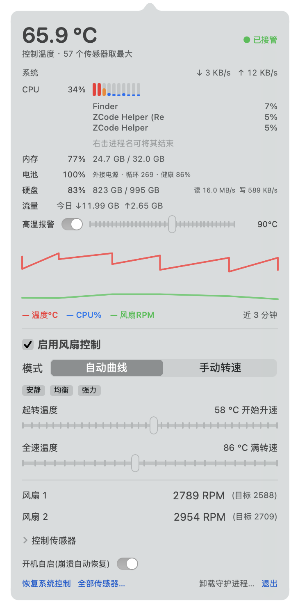
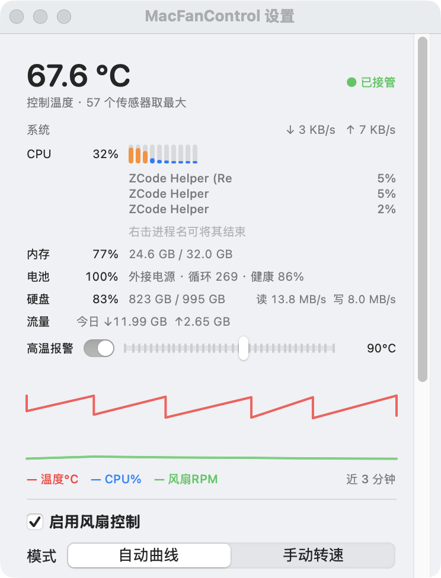

# MacFanControl 🌡️

**Free & open-source macOS fan control + system monitoring menu bar app** — a self-built alternative to Macs Fan Control / TG Pro / iStat Menus.

  

> Developed and battle-tested on a 16" MacBook Pro (M1 Max / macOS 26).

## Screenshots

| Menu bar panel | Settings window |
|:---:|:---:|
|  |  |

## Features

**Fan control**
- Multi-point temperature curves per fan (piecewise linear, editable UI)
- **Separate AC / battery curves** — auto-switch when you unplug, one-click copy
- **Night schedule** — preset curve within a time window (e.g. 23:00–07:00)
- Manual RPM mode, one-click full speed, 3 presets (Quiet / Balanced / Turbo)
- **Fan failure alert** — notification when RPM drops to ~0 while target is high
- Choose which sensors drive the curve (max value), full sensor browser
- Safety clamps, passive write verification, 1.5 °C hysteresis anti-flapping
- M1/M2 direct writes, M3/M4 automatic `Ftst` unlock, M5 lowercase keys, Intel legacy path

**System monitoring**
- CPU (total + per-core bars + Top 5 processes with kill-on-right-click, memory ranking)
- Memory (+ pressure level & swap warning), battery (health/cycles/live watts/daily Wh/charge alerts), disk
- Network speed + daily traffic, 15-min history charts, **today's peaks** (temp/CPU/watts)
- 7-day hourly trends (temp/CPU/GPU), **CSV export**, GPU utilization, high-temp notifications
- **Customizable menu-bar title**: temp / CPU / GPU / memory / net / battery / watts

**Extras**
- Version check against GitHub Releases, one-click diagnostics export
- Crash auto-recovery (LaunchAgent), watchdog self-healing daemon, bilingual UI (中/EN)

## Install

Download the DMG from [Releases](../../releases), drag to Applications. First launch: right-click → Open (unsigned freeware). Monitoring works with zero permissions; fan control installs a root helper with one admin password.

Or build from source (requires Xcode command line tools):

```bash
git clone https://github.com/skydeadpeng/MacFanControl.git
cd MacFanControl && ./build.sh && open build/FanBar.app
```

## How it works

```
┌────────────┐  unix socket (JSON)   ┌──────────────────────┐  IOKit/AppleSMC   ┌───────┐
│  FanBar.app │ ◄──────────────────► │  fanctl daemon(root) │ ◄───────────────► │  SMC  │
└────────────┘                       └──────────────────────┘                  └───────┘
```

Pure Swift, zero third-party dependencies. The SMCKit library (SMC protocol, Apple Silicon float decoding, per-model write strategies) is reusable in your own projects.

## Supported machines

Apple Silicon M1–M5 (full control) · Intel Macs (min-RPM channel) · macOS 13+ · MacBook Air = monitoring only.

## License

[MIT](LICENSE) © 2026 skydeadpeng
